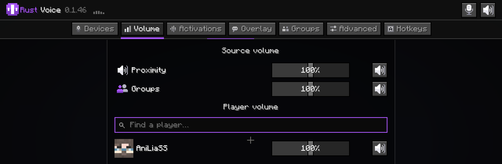

# Rust Voice

Голосовой чат по расстоянию для [Horizon](https://playhorizon.dev), переписанного на Rust Minecraft 26.3. Говорите с игроками на серверах с **Plasmo Voice** или **Simple Voice Chat**, в том числе с теми, кто играет с этими модами в обычном Java-лаунчере.

**Нативный мод Horizon**: лаунчер встраивает его в игру при сборке. Нативные моды работают без песочницы, с правами вашей учётной записи, поэтому прочитайте исходники перед сборкой.



## Что умеет

- **Два протокола в одном моде.** При входе на сервер мод запрашивает Plasmo Voice (v2) и Simple Voice Chat (2.6 и 2.7, совместимость 20 и 21) и работает с тем, кто ответил. На серверах Horizon он подключается и к собственному voicechat-server Horizon (Simple Voice Chat 2.6 через сообщения модов Horizon). Какой используется, видно во вкладке «Продвинутые».
- **Чистый микрофон:** фильтр низких частот, автоусиление с мягким ограничителем, шумовой порог с предзахватом и гистерезисом, спектральное шумоподавление. «Запомнить шум» записывает гул комнаты, чтобы его вычитать.
- **Голоса в 3D:** стерео с «тенью головы» (разница во времени и громкости между ушами), тише и глуше с расстоянием (воздух съедает верха), глуше за стенами.
- **Звук огибает углы:** если между вами стена, голос идёт из двери или коридора, через который он проходит (поиск пути по ближайшим блокам), а не сквозь стену.
- **Значки над никами:** микрофон над каждым игроком заполняется фиолетовым по громкости голоса; у кого выключен микрофон — перечёркнутый микрофон, выключен звук — перечёркнутые наушники, нет голосового мода — серый знак «нет». За стеной значок тускнеет. Значок стоит ровно там, где игра рисует ник, и не отстаёт при беге и прыжках.
- **Ноты над пластинкой:** пока сервер играет пластинку или другой звук в точке мира (pv-addon-discs), из неё в такт музыке вылетают разноцветные ноты, как у нотного блока, и разбиваются о блоки над ней. Над проигрывателем висит табличка с названием трека, крутящейся пластинкой и полосками громкости. Всё рисует сам мод, за стенами не видно, выключается во вкладке «Оверлей». Замурованный в блоки проигрыватель звучит глухо.
- **Меню групп для Plasmo Voice:** на серверах с аддоном pv-addon-groups во вкладке «Группы» видно группы сервера и их участников, можно войти, выйти, позвать игроков рядом и создать свою (название и пароль вводятся прямо в меню). У самого аддона есть только команды в чате; мод шлёт их сам и читает ответы, не засоряя чат.
- **Группы Simple Voice Chat:** та же вкладка «Группы» на серверах Simple Voice Chat — список групп и участников, вход (с паролем), выход и создание группы с выбором типа: обычная, открытая, изолированная. В обычной группе работают две рации: «Группы» говорит группе, «Локальный» — только тем, кто рядом (на это время мод выходит из группы и возвращается; начало фразы не теряется). Если вы в группе один, мод из неё не выходит.
- **Группы сразу видно:** пока вы говорите, на экране белый микрофон — голос рядом, фиолетовый микрофон — голос в группу (аддон групп Plasmo Voice, группы Simple Voice Chat). Кто говорит в вашей группе, отмечен фиолетовой рамкой и по желанию собран в отдельный список в своём углу экрана (вкладка «Оверлей», можно выключить). Ползунок «Группы» задаёт их громкость.
- **Звуки мира с серверов Plasmo Voice:** пластинки (pv-addon-discs) и другие звуки, которые сервер ставит в мир, звучат из проигрывателя или от сущности, глуше за стенами и огибают углы, как голоса. У них своя громкость «Музыка и звуки».
- **Активации Plasmo Voice:** голосовая активация, push-to-talk на трёх клавишах, дистанция для каждой активации, как их задал сервер.
- **Русский, украинский и английский интерфейс:** берётся язык, выбранный в самой игре (Настройки > Язык), или любой на выбор во вкладке «Продвинутые».
- **Меню** (клавиша **M**, или `/voice`, `/vm`): устройства, громкость каждого игрока (листается колесом), активации, оверлей, клавиши (переназначаются прямо в меню) и продвинутые настройки. `/voice mute` и `/voice deaf` выключают микрофон и голосовой чат.
- **Громкость игрока колесом:** зажмите ПКМ, наведитесь на игрока и крутите колесо — над его ником появится маленькая фиолетовая плашка с процентами.

## Чего пока нет

- **Шёпот** Simple Voice Chat не отправляется.
- Звуки «в точке мира» от плагинов Simple Voice Chat играют, но без привязки к месту.
- В Simple Voice Chat 2.6 другие игроки не видят, что у вас выключен микрофон (в этой версии протокола этого нет), — только выключенный звук.

## К чему мод обращается

- **Сеть:** одно UDP-подключение к голосовому порту Minecraft-сервера, на котором вы играете (адрес и порт присылает этот сервер). Звук Plasmo Voice шифруется AES-CBC ключом от сервера (обмен через RSA), пакеты Simple Voice Chat — AES-128-GCM секретом от сервера. Других адресов мод не трогает.
- **Микрофон и динамики:** через cpal, только пока есть подключение к голосовому серверу. Голос отправляется только при включённой активации (голосовая активация или зажатая клавиша push-to-talk).
- **Файлы**, все в `~/.config` (на Windows `%USERPROFILE%\.config`): `horizon-voice-mod.conf` (настройки), `horizon-voice-mod.noise` (запомненный шум), `horizon-voice-mod.mute` (выключатель микрофона) и `horizon-voice-mod.log` (лог). Больше ничего не читается и не пишется.

## Сборка

```sh
sh pack.sh            # build/rust_voice-<версия>.hnmod
```

В `.hnmod` лежат `horizon-native.json`, файлы `.rs` и `.toml` и `LICENSE`, ровно как у `native.py package` из horizon-mods. Тесты: `cargo test` в `mixins/rust_voice/api`.

Иконки генерируют `tools/gen_icons.py` (`src/icons.rs`) и `tools/mod_icon.py` (`assets/icon.png`).

## Не связан с другими проектами

Не сделан, не одобрен и не поддерживается авторами Plasmo Voice или Simple Voice Chat. В нём нет их кода и картинок: протоколы написаны с нуля на Rust, иконки нарисованы для этого проекта.

## Авторы

Разработал AniLiaSS с помощью ИИ (Claude от Anthropic). Автор решает, что войдёт в мод, проверяет его в игре и отвечает за него.

## Лицензия

MIT, см. [LICENSE](LICENSE).
